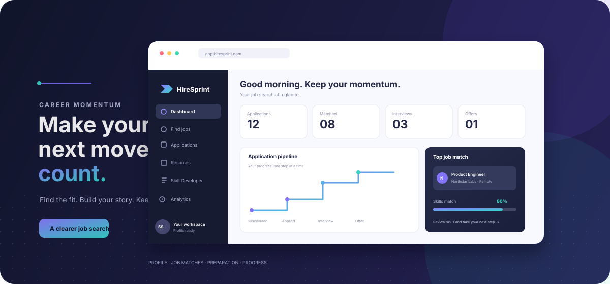
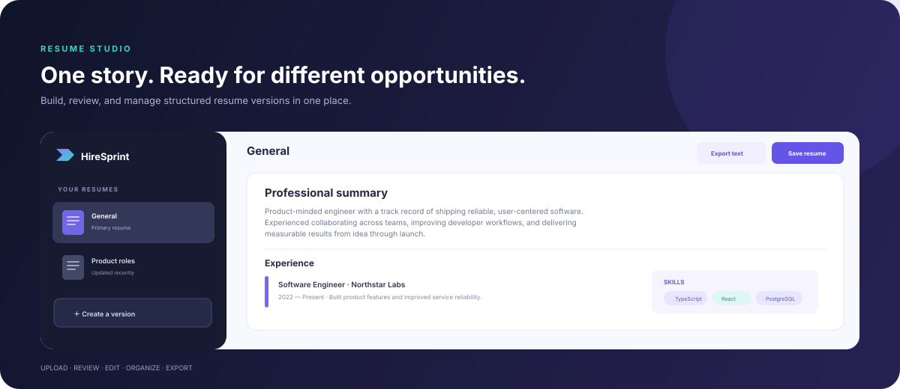
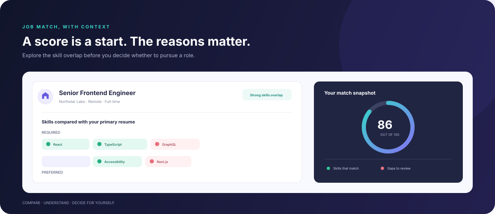
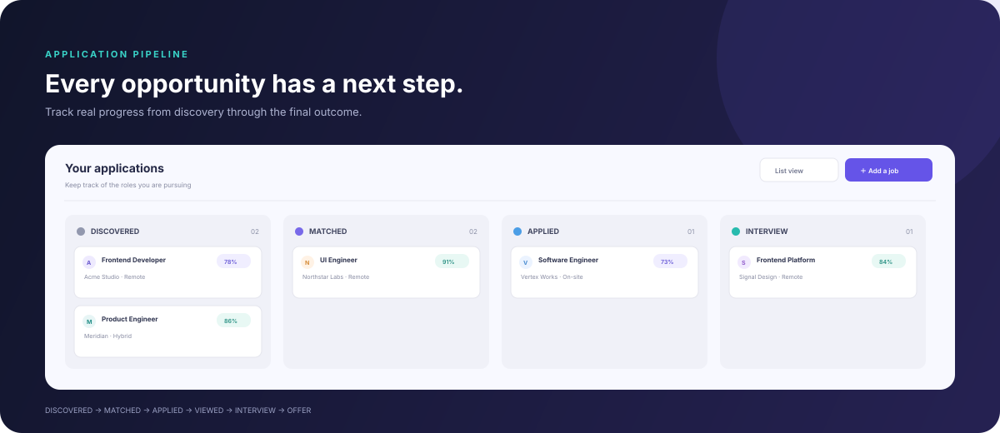
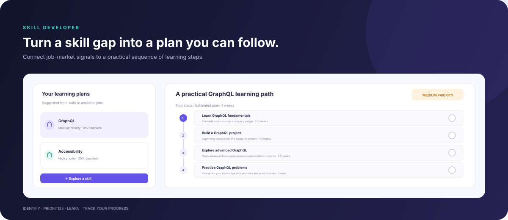

<div align="center">

# HireSprint

### Your next opportunity deserves a better system.

**A focused career workspace for the complete job-search journey.**

[](https://hire-sprint-eight.vercel.app)
[](https://react.dev/)
[](https://www.typescriptlang.org/)
[](https://supabase.com/)

<br />



**Don't just browse jobs. Build a search you can move forward.**

[🚀 Visit HireSprint](https://hire-sprint-eight.vercel.app) · [Explore the code](https://github.com/Sashank096/HireSprint) · [Run it locally](#run-it-locally)

</div>

---

## One workspace. The whole job-search journey.

Searching for a new role often means juggling job boards, resume copies, notes, interview prep, and follow-up reminders. HireSprint brings those moving parts into one account-aware workspace — from the first profile details to the latest application update.

> **Build your profile → understand your matches → prepare thoughtfully → track every opportunity → learn what to improve**

HireSprint is built to help people stay organized and make informed decisions. It does **not** automatically apply for jobs or promise a hiring outcome.

## Product tour

The panels below are **illustrative product-tour graphics**, designed from HireSprint's real feature set and visual language. They are not live-account screenshots or seeded user data.

### 01 · Your career home base

Bring the job search into focus: see the shape of your pipeline, recognize the next action, and keep your strongest matches close.


### 02 · Make your resume work harder

Bring in an existing PDF or text resume, review the extracted structure, and create focused versions for different opportunities. Select a primary resume, keep skills organized, and export a text copy when you need one.



### 03 · See the reasons behind a match

HireSprint compares job requirements with skills from your profile or resume. The score is a quick signal; the matched and missing skills provide the context to decide whether the role is worth pursuing.



### 04 · Keep every application moving

Give each opportunity a place in your pipeline. Move it through the stages that reflect your real-world progress, then use list or board views to focus your follow-up.



### 05 · Turn skill gaps into a learning path

See which skills appear across the available job listings, build a practical learning plan, and record progress as you complete its steps.



<div align="center">

### Ready to see the real thing?

[](https://hire-sprint-eight.vercel.app)

[https://hire-sprint-eight.vercel.app](https://hire-sprint-eight.vercel.app)

</div>

## What HireSprint helps you do

| Workspace | What it helps you do |
|---|---|
| **Account & profile** | Sign in with email/password; optional OAuth and recovery methods depend on Supabase provider configuration. Complete the guided profile with roles, location, skills, and preferences. |
| **Resume studio** | Upload PDF/text resumes; extract text and recognize image-only PDF content with OCR; review and edit versions, choose a primary resume, and export text. |
| **Job discovery** | Browse jobs available in your connected database, filter the feed, compare your skill match, and inspect required/preferred skill gaps. |
| **Job workspace** | Review job details, save an editable cover-letter draft and interview-practice questions, and follow the employer's application link when available. |
| **Application pipeline** | Track roles through Discovered, Matched, Applied, Viewed, Interview, Offer, and Rejected in board or list views. |
| **Skill Developer** | Identify missing skills represented in available listings, create a four-step learning plan, and save completed-step progress. |
| **Analytics** | Review application totals, funnel stages, outcomes, and related summary metrics from your tracked pipeline. |
| **Settings** | Manage your profile and preferences, including work mode, salary expectations, and display currency. |

### Important: what is and isn't automated

The current matching score is **rule-based**, not an AI prediction. Cover letters, interview questions, and learning plans are generated from **local templates**, not from a connected large language model. Review and personalize generated drafts before using them. Job listings must already exist in the connected Supabase `jobs` table; HireSprint does not currently crawl third-party job sites or automatically submit applications.

## How it works

### 1. Set up your career profile

Create an account through Supabase Auth, then complete onboarding with the information you want to use for job discovery: target roles, location, experience, skills, and work preferences. Profile and selected-skill data are stored in your account.

### 2. Bring your resume into the workspace

Upload a PDF or text file, or create a resume from scratch. PDF text is extracted in the browser; if a PDF is image-only, OCR is used to recognize text. Review what was parsed, edit it into a useful version, and choose which resume to use as your primary version.

### 3. Discover and evaluate roles

The job feed reads from the connected Supabase `jobs` table. Compare job requirements to profile or resume skills, apply available filters, and use missing-skill details to understand where a role fits.

### 4. Prepare, then take action

Open a role to review its details, build a starting cover-letter draft, or generate interview-practice prompts. Add the opportunity to your pipeline and use the employer link to apply yourself when ready.

### 5. Track progress and keep learning

Update the application stage as your search moves forward. Create learning plans from skills represented in available listings, check off completed steps, and review the pipeline in analytics.

## What is saved

| Data | Where it lives | Examples |
|---|---|---|
| Account and career profile | Supabase Auth + `profiles` | Name, location, headline, target roles, preferences, onboarding status |
| Profile skills | `skills` + `profile_skills` | Skill catalog entries and the skills associated with your profile |
| Resume versions | `resumes` | Label, structured resume content, primary-resume selection |
| Job catalog | `jobs` | Listings shared by the connected project |
| Application tracking | `applications` | Job, current stage, match score, application method, and dates |
| Learning progress | `learning_plans` | Learning plan and completed step titles per account and skill |
| Saved preparation | `job_preparations` | Cover-letter draft and interview questions for a job |

Database migrations enable Row Level Security and owner-scoped policies for personal data. Apply every migration to your Supabase project before using the app; the client key alone does not create the schema or policies.

## Designed for a clear, reviewable workflow

- **You stay in control:** Review job matches and generated drafts; choose when and where to apply.
- **The reasons stay visible:** Skill overlap and missing requirements help explain a match score.
- **Your work stays organized:** Resumes, applications, job preparation, and learning progress have dedicated spaces.
- **Your data is account-scoped:** Supabase Auth and Row Level Security are used for persisted personal records.
- **The UI adapts:** The workspace uses a responsive sidebar-and-content layout, with focused views for each part of the search.

### Under the hood

```text
React + TypeScript browser app
  ├── Supabase Auth ─────────── account and session
  ├── Supabase Postgres ─────── profiles, skills, resumes, jobs,
  │                             applications, plans, preparation
  │      └── Row Level Security scopes personal records to the signed-in user
  └── Edge Function ────────── currency-rates lookup
```

The browser uses the public Supabase client key and the signed-in session. Supabase Row Level Security (RLS) policies are essential for protecting account-owned rows. **Never place a service-role key, database password, or other secret in a `VITE_*` variable.**

### How the match score is calculated

The app normalizes skill names and compares overlap:

- Required skills contribute up to **60 points**.
- Preferred skills contribute up to **25 points**.
- The formula adds a **15-point baseline** and caps the score at **100**.
- Missing required skills are listed separately.

This is a simple, explainable skills-overlap signal — not a prediction of interview, hiring, or job performance.

## Run it locally

### Requirements

- Node.js 18 or newer
- npm
- A Supabase project with the app's migrations applied

### 1. Get the code

```bash
git clone https://github.com/Sashank096/HireSprint.git
cd HireSprint
npm install
```

### 2. Configure Supabase

Create `.env.local` (next to `package.json`) with your Supabase project's **Project URL** and **publishable/anon key**:

```dotenv
VITE_SUPABASE_URL=https://YOUR_PROJECT_REF.supabase.co
VITE_SUPABASE_ANON_KEY=YOUR_SUPABASE_PUBLISHABLE_OR_ANON_KEY
```

These are public client configuration values, not secret credentials. Do not commit real environment files. The repository ignores `.env*` files.

Apply the SQL files in [`supabase/migrations`](./supabase/migrations) to your Supabase project in timestamp order. You can use the Supabase SQL Editor or the Supabase CLI. The migrations create the app schema, authentication profile trigger, Row Level Security policies, generated-data tables, and required authenticated-role grants. Do not skip them: a connected project without the schema will not support sign-in/profile loading or app data.

If you enable Google or GitHub sign-in, configure the corresponding provider credentials and redirect URLs in Supabase Auth. Configure the site's allowed redirect URLs for your local and deployed app URLs as well.

### 3. Start the development server

```bash
npm run dev
```

Open the local URL printed by Vite (normally `http://localhost:5173`).

### 4. Build and verify

```bash
npm run typecheck
npm run lint
npm run build
npm run preview
```

## Deploy

The deployed app is hosted on Vercel: [hire-sprint-eight.vercel.app](https://hire-sprint-eight.vercel.app). To deploy your own copy:

1. Import the repository into Vercel and use the repository root as the project root.
2. Add `VITE_SUPABASE_URL` and `VITE_SUPABASE_ANON_KEY` as Vercel environment variables for the environments you use.
3. Apply the Supabase migrations and configure authentication redirect URLs for your deployment domain.
4. Deploy with the Vite defaults (`npm run build`, output directory `dist`).

## Built with

- **React 18**, **TypeScript**, and **Vite 5**
- **Tailwind CSS 3** for styling
- **React Router 7** for page routing
- **Supabase** for PostgreSQL, authentication, Row Level Security, and Edge Functions
- **PDF.js** and **Tesseract.js** for client-side PDF/text resume extraction and OCR support
- **Lucide** for interface icons

## Available screens

| Route | Screen |
|---|---|
| `/` | Public landing page |
| `/auth` | Sign in, account creation, and configured recovery/provider options |
| `/onboarding` | Four-step profile and preference setup |
| `/app` | Career dashboard and pipeline overview |
| `/app/jobs` | Job feed, matching, and filters |
| `/app/jobs/:jobId` | Job details, skill gaps, preparation, and pipeline actions |
| `/app/applications` | Application board/list and stage management |
| `/app/resumes` | Resume upload, builder, and saved versions |
| `/app/skills` | Skill-gap analysis and learning plans |
| `/app/analytics` | Application funnel and summary metrics |
| `/app/settings` | Profile and job-search preferences |

Authenticated routes require a signed-in user and completed onboarding. On a new Supabase project, the database migrations must be applied and the account must finish onboarding before the main workspace becomes available.

## Project map

```text
.
├── public/                 # Static assets, including the README illustration
├── src/
│   ├── components/         # Shared interface components
│   ├── context/            # Authentication and profile context
│   ├── hooks/              # Application and currency hooks
│   ├── layouts/            # Authenticated app shell
│   ├── lib/
│   │   ├── api.ts          # Supabase data-access helpers
│   │   ├── resume-parser.ts # Resume file parsing and skill extraction
│   │   ├── supabase.ts     # Supabase browser client
│   │   └── utils.ts        # Validation, formatting, and match scoring
│   ├── pages/              # Landing, auth, onboarding, jobs, resumes, etc.
│   ├── types/              # Shared TypeScript data types
│   ├── App.tsx             # Routes and onboarding access guard
│   └── main.tsx            # Browser entry point
└── supabase/
    ├── migrations/         # Ordered schema, policy, and grant migrations
    └── functions/          # currency-rates Edge Function
```

## Data and privacy

The database stores account-owned data such as profiles, resumes, applications, learning plans, and job-preparation drafts. The shared `jobs` and `skills` catalogs are used to power discovery and matching. Row Level Security policies scope personal records to their owner; the browser communicates with Supabase using the public client key and the signed-in user's session.

The app's migrations are in [`supabase/migrations`](./supabase/migrations). Apply them to a Supabase project you control and review the project's Auth, database, and Edge Function configuration before production use.

## License

This project is released under the [MIT License](./LICENSE).

---

<div align="center">
Built for the next great career move.
</div>
